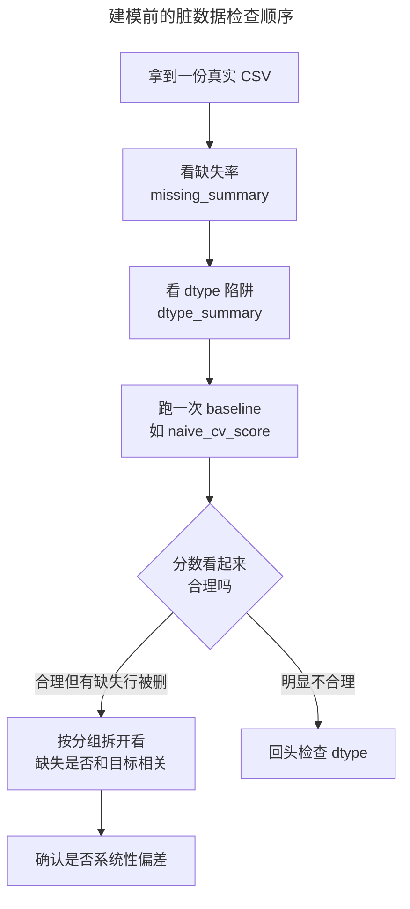

> 作者：轻松学AI
> 日期：2026-10-16
> 风格：通俗科普 + 实操教程
> 状态：待发布

# 机器学习实战 #01：别急着建模，一份真实数据能有多脏

在《从零开始学机器学习》里，你已经知道了模型、参数、损失是怎么配合着找出一条最佳直线的。那些练习用的数据干净又整齐，每一行都齐齐整整，没有空格，没有乱码。

真实数据不是这样的。

拿 Kaggle 上最经典的练手数据集泰坦尼克号乘客名单来说：891 名乘客，年龄这一列缺了 177 个。拿去直接训练一个随机森林，五折交叉验证跑出 0.692 的准确率——看着还凑合，像是能用。

问题是，这个分数是假的。不是算错了，是**被丢弃的那部分乘客，存活率系统性地偏低**。模型从一开始学的，就是一份被动过手脚的样本。这一篇要讲的，就是怎么在建模之前，先把这个坑看清楚。

## 一份 CSV 打开之后，你该先看什么

拿到任何一份真实数据，第一件事不是建模，是摸清楚它有多"脏"。

拿到一份真实数据，有点像收到一堆揉皱的问卷——字迹模糊、有的页角缺了一块、有的干脆是空白。能直接拿来用的，往往只是其中薄薄一叠：


配套仓库里的 `data_loader.py` 把加载过程封装成一行：`load_titanic()`，拿到的就是一张 891 行、15 列的表。表面上看挺规整——行列对齐，没有乱码。麻烦藏在细节里。

先看缺失值。配套仓库 `explore.py` 里的 `missing_summary(df)` 统计了每一列的缺失数量和缺失率，结果是这样的：

| 列名 | 缺失数 | 缺失率 |
|------|--------|--------|
| age | 177 | 19.9% |
| embarked | 2 | 0.2% |
| embark_town | 2 | 0.2% |
| deck | 688 | 77.2% |

`deck`（客舱甲板）缺了近八成，这列基本废了——不是填补能救回来的，是这个字段本身在当年的记录里就大量缺失。`age` 缺了近两成，量级足够影响训练，但还有救。剩下的列几乎没缺失，看起来很干净。

这张缺失值分布图，是从真实数据直接导出的，不是手绘示意：


红色条纹是缺失的位置。注意看 `age` 那一列——红色条纹不是均匀撒在全表里的，有明显的聚集。这个细节很重要，后面会用到。

再看数据类型。`dtype_summary(df)` 把每列的类型和唯一值个数列出来，三个坑逐一浮现：


`deck` 是字符串类型，缺失率摆在那儿，模型根本用不上。`age` 是标准的 `float64`，可以直接喂给模型。`pclass`（舱位等级）是 `int64`，看起来像数字，但 1、2、3 只是舱位的类别标签，数值大小没有任何实际意义——如果模型把它当成可以做加减乘除的连续数值去学，学出来的权重会很怪。

这就是读一份真实 CSV 和读一份教学数据集最大的区别：教学数据集已经帮你把这些坑填平了，真实数据不会。

## 一个看起来能用的模型，分数从哪来的

现在把这份数据直接丢给模型，看看会发生什么。

最省事的处理方式是：数值列里有缺失就直接删掉那一行，剩下的喂给随机森林，跑五折交叉验证。配套仓库里 `naive_cv_score()` 这个函数复现的就是这个过程：

```python
def naive_cv_score(df: pd.DataFrame, target_col: str, seed: int = 0) -> float:
    """不做任何清洗：直接 dropna，数值列喂给随机森林做 5 折交叉验证。
    用来复现"看起来能跑的模型"分数虚高的假象——dropna 丢掉的不是随机样本，
    而是系统性偏差（比如年龄缺失的乘客本身就和存活率相关）。
    """
    numeric = df.select_dtypes(include="number").dropna()
    y = numeric[target_col]
    X = numeric.drop(columns=[target_col])
    clf = RandomForestClassifier(n_estimators=50, random_state=seed)
    # dropna 后样本量可能很小，折数不能超过最小类别的样本数，
    # 否则 StratifiedKFold 无法分层——教学场景（如小样本单测）里真实存在。
    n_splits = min(5, y.value_counts().min())
    cv = StratifiedKFold(n_splits=n_splits, shuffle=True, random_state=seed)
    scores = cross_val_score(clf, X, y, cv=cv)
    return float(scores.mean())
```

跑一遍，分数是 0.692。891 名乘客，dropna 之后剩下 714 个样本——光是这一步就丢了 177 行，刚好是 `age` 缺失的数量。


0.692 看起来是个能接受的起点，不算惊艳但也不算差。问题是——这个分数到底在衡量什么？

## 被丢掉的那 177 行，不是随机抽的

dropna 这个动作听起来很中立：缺失就扔掉，剩下的照常训练。但"谁的年龄会缺失"这件事本身，和"谁会存活"这件事，在泰坦尼克号的数据里是绑在一起的。

把这 891 名乘客分成三组：全体乘客、年龄没缺失（naive 模型实际训练用到的样本）、年龄缺失（被 dropna 整行丢弃的样本），分别算存活率：


全体乘客的存活率是 38.4%。年龄没缺失的乘客存活率是 40.6%，和全体差不多。但年龄缺失的那部分乘客，存活率只有 29.4%——明显偏低，偏低了快 10 个百分点。

第一次把这三个数字摆在一起看的时候，说实话有点意外——本来以为缺失会是均匀分布在各类乘客身上的噪声，结果它偏偏挑中了更可能遇难的那群人。

说白了就是：dropna 丢掉的不是一份随机样本，是一份存活率系统性偏低的样本。模型训练时，看到的 714 个人里，那些"更不容易存活"的乘客被提前筛掉了一部分。分数好看，是因为数据集本身被悄悄"美化"过。

有意思的是，这个偏差不是凭空出现的。为什么年龄缺失的人存活率更低？按舱位等级拆开看就清楚了：

| 舱位 | 年龄缺失数 | 年龄缺失率 | 该舱位存活率 |
|------|-----------|-----------|-------------|
| 一等舱 | 30 | 13.9% | 63.0% |
| 二等舱 | 11 | 6.0% | 47.3% |
| 三等舱 | 136 | 27.7% | 24.2% |

三等舱乘客的年龄缺失率是一等舱的两倍，而三等舱的存活率本身就远低于一等舱——当年的登记记录对低舱位乘客本就更粗糙，这是历史原因，不是随机噪声。年龄缺失和舱位绑在一起，舱位又和存活率绑在一起，这条链一拉出来，"缺失不是随机的"就不再是一句空话。

这种缺失机制有个名字，叫 MAR（Missing At Random，随机缺失但依赖于其他可观测变量）——区别于完全随机缺失（MCAR）。统计学上这是三种缺失机制里最常见的一种，但大多数人写代码时根本没意识到自己正在假设数据是 MCAR。

0.692 这个分数，看起来是"模型学到了东西"，实际上一部分来自"样本被挑选过"。这不是模型的错，是喂给模型的数据本身带着偏差。

## 发现偏差之后，能做什么

知道问题在哪，下一步自然是想办法补救，而不是继续假装没看见。

最直接的笨办法是回答一个问题：如果年龄缺失的人也留在训练集里，分数会怎么变？保留全部样本、用一个不依赖 age 的更简单模型做对照，是验证这个假设的第一步——但那已经是填补策略要解决的问题了，牵涉到均值填补、分组填补、KNN 填补这几种不同的代价权衡。

这一篇到这里，可以把拿到任何一份真实数据后该走的检查顺序理出来：



现在能做的，是把这次探查的结论钉住：

- 任何一份真实数据，先看缺失率和 dtype，再看建模结果。
- dropna 看起来是"简单粗暴但安全"的选择，实际上可能悄悄引入系统性偏差。
- 一个"看起来能跑"的交叉验证分数，先问一句——这个分数背后，样本是怎么被挑出来的？

下一篇，我们就把"删缺失行"这一步拆开，看看均值填补、分组填补和 KNN 填补这三种策略，各自在准确率和样本量之间做了什么权衡。

---

本文的数据探查与建模代码，以及缺失值分布图、存活率对比图的真实数据，都在配套仓库里：[ml-practice](https://github.com/Joneyao/ml-practice)。

- [Titanic - Machine Learning from Disaster](https://www.kaggle.com/c/titanic/)
- [Hands-On Machine Learning with Scikit-Learn, Keras, and TensorFlow, 3rd Edition](https://www.oreilly.com/library/view/hands-on-machine-learning/9781098125967/)
- [pandas 官方文档：Working with missing data](https://pandas.pydata.org/docs/user_guide/missing_data.html)
- [MCAR, MAR, and MNAR Missingness Explained](https://metricgate.com/blogs/mcar-mar-mnar/)
