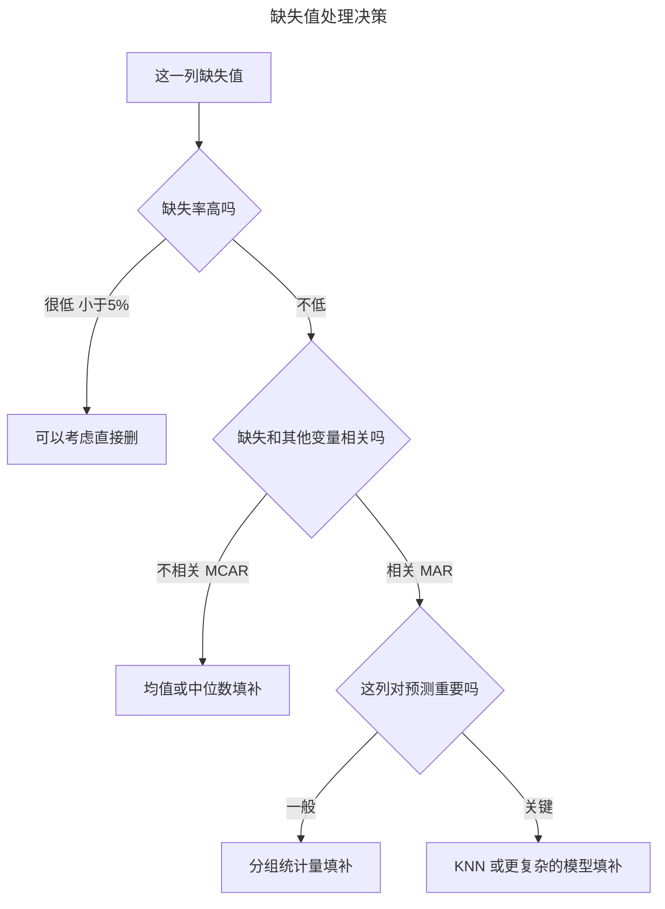

> 作者：轻松学AI
> 日期：2026-10-16
> 风格：通俗科普 + 实操教程
> 状态：待发布

# 机器学习实战 #02：缺失值不是删掉就完事，填补策略的代价

上一篇我们打开一份没清洗过的泰坦尼克数据，发现一个什么都没处理的模型，交叉验证分数居然还凑合。那是假象——`dropna` 顺手丢掉的样本根本不是随机抽的。

这一篇把这件事拆开讲清楚：到底丢了谁，丢了之后该怎么补。先说结论——直接删掉缺失年龄的乘客，丢掉的不是运气不好的一小撮人，是三等舱乘客这一整类群体。用均值、分组中位数、KNN 三种方式去猜这个空着的年龄，结果也没有哪种是万能解。每种猜法都有自己的代价，搞清楚代价是什么，比记住哪个函数叫什么更重要。

## 缺失不是"随机漏了几个"，而是有迹可循

泰坦尼克数据里，`age` 这一列缺了 177 个值，缺失率接近两成。第一个该问的问题不是"怎么填"，是"为什么缺"。

统计学上这个问题有个专门的分类框架，叫缺失机制：完全随机缺失（MCAR）、随机缺失（MAR）、非随机缺失（MNAR）。MCAR 是缺失和任何变量都没关系，纯粹运气。MAR 是缺失和你观察到的其他变量有关，比如"三等舱乘客的年龄更容易漏填"。MNAR 最麻烦——缺失原因和那个缺失值本身有关，比如"年龄特别大的人故意不填"。

这套分类来自统计学家 Donald Rubin 1976 年的原始论证，判断起来需要专门的统计检验。这篇文章和配套代码里用的是教学简化版——按某个分组列比较缺失率，差异明显就判成 MAR，差异不明显就判成 MCAR，不碰 MNAR 的统计检验。这个简化版能帮你建立直觉，拿去做严谨的统计推断就不够用了。

配套仓库里的这个判定函数长这样：

```python
def classify_missingness(df: pd.DataFrame, col: str, group_col: str,
                          threshold: float = 0.1) -> str:
    """简化版缺失机制判定：按 group_col 分组比较缺失率，
    组间最大差异超过 threshold 判为 MAR，否则判为 MCAR。
    """
    rates = df.groupby(group_col)[col].apply(lambda s: s.isna().mean())
    if rates.max() - rates.min() > threshold:
        return "MAR"
    return "MCAR"
```

把 `age` 按 `pclass`（舱位等级）分组一跑，三个舱位的缺失率是：一等舱 13.9%，二等舱 6.0%，三等舱 27.7%。最大差了 21.7 个百分点，远超过函数里设的 10% 门槛，判定结果是 MAR。


这张图比统计检验更直观。三等舱乘客的年龄缺失率是二等舱的四倍多。换句话说，缺不缺年龄，跟你坐哪个舱位有很强的关系——而舱位本身又跟存活率、票价高度相关。缺失不是撒了把随机的盐，是跟着社会分层走的。

这就是为什么"直接删掉有缺失的行"这个最省事的做法，代价比看起来大。往下看具体怎么大。

## 三种填补策略：猜一个空格该填什么

缺失值补不补、怎么补，本质上是在猜一个没填的空格该写什么。猜法不同，用到的信息量也不同。


最省事的猜法是整体均值：不管这个乘客是谁，统一填一个全局平均年龄。它简单、快，但完全没看上下文——对三等舱的年轻水手和一等舱的老绅士用同一个数字去猜，猜错的概率不会小。

退一步，分组中位数会看一点上下文：按舱位分组，组内取中位数填补。三等舱乘客普遍年轻，一等舱乘客普遍年长，分组之后猜的数字会更贴近真实分布。配套代码里这两种填法分别是：

```python
def impute_mean(df: pd.DataFrame, col: str) -> pd.Series:
    return df[col].fillna(df[col].mean())


def impute_grouped_median(df: pd.DataFrame, col: str, group_col: str) -> pd.Series:
    return df.groupby(group_col)[col].transform(lambda s: s.fillna(s.median()))
```

工程上，均值/中位数这类统计量填补一般不会手写 `fillna`，会用 `sklearn.impute.SimpleImputer`——接口统一，能直接塞进 Pipeline，还能保存训练集算出的统计量供预测时复用。这是 scikit-learn 自带的标准组件，不是什么新发明，用它只是图省事和图规范。

猜得更细一点的办法是 KNN 填补：找这个乘客在其他特征上最相似的几个人，参考他们的真实年龄。配套代码用的是 `sklearn.impute.KNNImputer`：

```python
def impute_knn(df: pd.DataFrame, cols: list[str], n_neighbors: int = 5) -> pd.DataFrame:
    imputer = KNNImputer(n_neighbors=n_neighbors)
    filled = imputer.fit_transform(df[cols])
    return pd.DataFrame(filled, columns=cols, index=df.index)
```

KNN 看的上下文最多，计算量也最大——每补一个值都要算这个样本到所有其他样本的距离。数据量小的时候无所谓，数据量一大，这笔计算账就得算清楚再上。

三种猜法谁更准？不靠感觉，拿真实数据跑一遍交叉验证最诚实。

## 删 vs 填：分数说了什么，又没说什么

配套仓库里的 `compare_strategies` 把四种处理方式放在同一条起跑线上：删除缺失行、均值填补、分组中位数填补、KNN 填补，分别喂给同一个随机森林模型做 5 折交叉验证。

```python
def compare_strategies(df: pd.DataFrame, target_col: str,
                        age_col: str = "age", group_col: str = "pclass") -> pd.DataFrame:
    """对比四种策略对同一个随机森林交叉验证分数的影响。"""
    rows = []

    dropped = df.dropna(subset=[age_col])
    rows.append({
        "strategy": "dropna", "n_samples": len(dropped),
        "cv_score": _cv_score(dropped[[group_col, age_col]], dropped[target_col]),
    })

    mean_filled = df.copy()
    mean_filled[age_col] = impute_mean(df, age_col)
    rows.append({
        "strategy": "mean", "n_samples": len(mean_filled),
        "cv_score": _cv_score(mean_filled[[group_col, age_col]], mean_filled[target_col]),
    })

    grouped_filled = df.copy()
    grouped_filled[age_col] = impute_grouped_median(df, age_col, group_col)
    rows.append({
        "strategy": "grouped_median", "n_samples": len(grouped_filled),
        "cv_score": _cv_score(grouped_filled[[group_col, age_col]], grouped_filled[target_col]),
    })

    knn_filled = impute_knn(df, cols=[group_col, age_col])
    knn_filled[target_col] = df[target_col].values
    rows.append({
        "strategy": "knn", "n_samples": len(knn_filled),
        "cv_score": _cv_score(knn_filled[[group_col, age_col]], knn_filled[target_col]),
    })

    return pd.DataFrame(rows)
```

实测跑出来的结果，四种策略的分数是这样：


| 策略 | 样本量 | 5 折交叉验证平均分 |
|------|--------|----------------|
| dropna（删除） | 714 | 0.706 |
| mean（均值） | 891 | 0.689 |
| grouped_median（分组中位数） | 891 | 0.691 |
| knn | 891 | 0.690 |

看到这张表，第一反应可能是"删了反而分数最高，那还填什么"。这正是这张图最容易骗人的地方。

问题来了——这四个分数，压根不是在同一个人群上算出来的。`dropna` 那一行的 714 个样本，是把 177 个有缺失年龄的乘客整个踢出去之后剩下的人。而三等舱乘客的年龄缺失率是三等舱里独有的现象——踢出去的人里，76.8% 来自三等舱，这个比例在保留下来的样本里只有 49.7%。被踢出去的这群人，存活率是 29.4%，比保留下来的 40.6% 低了 11 个百分点。平均票价也只有 22.16，比保留下来的 34.69 便宜不少。

说白了就是：`dropna` 的 0.706 分，是在一个被筛过一轮、整体更富裕、更容易预测的子人群上考出来的。它没有变相证明"删除更好"，它只是换了一张更简单的考卷。真实世界里，你要预测的乘客里一样会有大量缺年龄的三等舱乘客——用 `dropna` 训出来的模型，对这群人根本没学过，也没法代表他们。

再看三种填补策略——均值、分组中位数、KNN，分数几乎没差（0.689 到 0.691 之间）。这不是说填补方法不重要，是因为这个实验只用了 `pclass` 和 `age` 两个特征，年龄本身能提供的区分力有限，三种猜法猜出来的值差异还没大到能在这么简单的模型里拉开分数。特征越多、模型越复杂，填补质量的差异才会被放大。

一个诚实的结论：这次实验里，决定分数高低的不是"填得准不准"，是"你有没有保留住本该难预测的那群人"。删除是最简单的处理方式，代价是悄悄把样本换成了一份更容易考的卷子。

## 什么时候删，什么时候填，上哪种填法

把前面的发现落到实际判断上，决策其实不复杂。



缺失率很低、且确认和其他变量没什么关系的时候，删几行代价不大。一旦缺失率不低，或者像泰坦尼克这样，缺失本身就是分层现象，删除就不只是丢了几个数据点，是丢了一整类人。这种情况下，宁可多花点工程量去填补，也不要图省事直接删。

填补方法怎么选，看这一列对最终预测有多重要。不太重要的列，分组统计量就够用。重要的列，值得上 KNN，甚至更复杂的基于模型的填补——多花的计算成本，换来的是没有悄悄丢掉你最想预测准的那群人。

入门系列讲过，模型本质上是在一堆参数里找让损失最小的那一组。这一篇想补的是：喂给模型的数据，如果已经被删得只剩下"容易预测"的那部分人，损失再小也只是在一张被筛过的考卷上考得好看。数据清洗不是模型训练前的打杂环节，是决定你的模型将来能不能用在真实世界的第一道关。

下一篇我们换一个数据集，看另一种更隐蔽的脏——不是缺了，是数值本身看起来不正常：异常值到底是噪声，还是真实存在的极端情况。

---

本文代码和真实运行数据都在配套仓库里：[ml-practice](https://github.com/Joneyao/ml-practice)。

- [scikit-learn 官方文档：Imputation of missing values](https://scikit-learn.org/stable/modules/impute.html)
- [KNNImputer API 文档](https://scikit-learn.org/stable/modules/generated/sklearn.impute.KNNImputer.html)
- [MCAR、MAR、MNAR 缺失机制详解（Rubin 1976 分类框架）](https://r-statistics.co/Missing-Data-Types-in-R-MCAR-MAR-MNAR.html)
- [Pandas 缺失值处理实战笔记](https://www.cnblogs.com/hankleo/p/11462830.html)
- [Titanic - Machine Learning from Disaster（Kaggle 数据集出处）](https://www.kaggle.com/c/titanic/)
