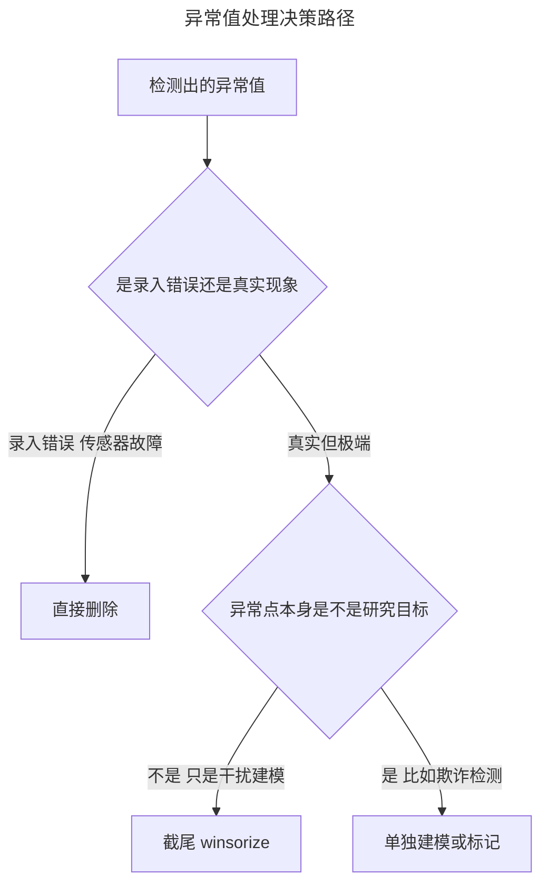

> 作者：轻松学AI
> 日期：2026-10-16
> 风格：通俗科普 + 实操教程
> 状态：待发布

# 机器学习实战 #03：异常值，是噪声还是真实的极端情况？

Kaggle 房价数据集（Ames 房价）里有一栋房子，居住面积 5642 平方英尺，是普通房子的三倍多。按常规套路，这种点一眼就会被当成异常值删掉。

删了之后发生了什么？模型的 R² 从 0.502 掉到了 0.485。

删除异常值不但没让模型变好，反而让它更差。截尾处理（把极端值夹到一个合理边界，而不是整行删掉）之后，R² 反而涨到了 0.509，是三种做法里最高的。这组数字来自配套仓库里跑出来的真实结果，不是凑出来的——而它恰好戳破了一个很多人下意识就信的假设：**异常值不是洪水猛兽，删它之前先问一句，它是不是真的。**

这一篇要讲清楚两件事：怎么技术上找出异常值，以及找出来之后，凭什么判断它该删、该留，还是该换种方式对待。

## 哪些点该被算成异常值

先解决最基础的问题：异常值不是"看着奇怪"就算，得有个客观标准。

最常用的一种叫 IQR 法（四分位距法）。把数据从小到大排好，取第 25% 分位数（Q1）和第 75% 分位数（Q3），中间这一段叫四分位距（IQR）。然后在 Q1 往下、Q3 往上各画一道"围栏"，越过围栏的点就判为异常值。

:::formula IQR 围栏
下围栏 = Q1 − 1.5 × IQR ｜ 上围栏 = Q3 + 1.5 × IQR
IQR = Q3 − Q1，1.5 是经验系数，围栏外的点判为异常值
:::


看这张图。中间的箱体是数据最集中的 50%（Q1 到 Q3），两条橙色虚线是围栏。箱体左右的黑色细线延伸到围栏为止，围栏外面那几个红点——包括右边那三个远离人群的点——就是 IQR 法判出来的异常值。

另一种常见方法是 Z-score 法，直接看一个点偏离均值多少个标准差。

:::formula Z-score
z = (x − 均值) / 标准差
|z| 超过阈值（常用 3）就判为异常值
:::

两种方法配套仓库里都写了，而且是同一个思路的两种量尺：

```python
def detect_iqr(series: pd.Series, k: float = 1.5) -> pd.Series:
    """IQR 法：超出 [Q1 - k*IQR, Q3 + k*IQR] 判为异常值。"""
    q1, q3 = series.quantile(0.25), series.quantile(0.75)
    iqr = q3 - q1
    lower, upper = q1 - k * iqr, q3 + k * iqr
    return (series < lower) | (series > upper)


def detect_zscore(series: pd.Series, threshold: float = 3.0) -> pd.Series:
    """Z-score 法：标准化后绝对值超过 threshold 判为异常值。"""
    z = (series - series.mean()) / series.std()
    return z.abs() > threshold
```

拿房价数据里的居住面积（GrLivArea）跑一遍：IQR 法揪出 31 个异常值，占全部样本的 2.1%；Z-score 法（阈值 3）揪出 16 个，两者重叠的点有 16 个——IQR 的"围栏"天生比 3 个标准差宽松一点，抓得更多。

说白了就是，两种方法给出的都只是"这个点和大多数不一样"这件事实。它们回答不了下一个问题：这个不一样，是哪儿来的。

## 房价数据里，这些"异常值"其实是真大房子

人群身高分布里有一个人，身高 226 厘米——姚明。


姚明这个点，统计学意义上妥妥是个异常值：远离人群，超出了普通人身高的任何合理围栏。但他不是测量错误，不是数据录入出了问题。他是真实存在的人，只是碰巧长得特别高。

房价数据里那些被 IQR 标记出来的大户型，是同一种情况。


这张图里，蓝色是正常值，红色是被 IQR 判为异常值的 31 个点。看右上角那几个——面积超过 4000 平方英尺、价格 70 多万美元的房子，它们确实偏离大多数房子所在的那片蓝色区域，但偏离的理由很直接：房子是真的大。查一下这些点对应的原始数据，`OverallQual`（整体质量评分）普遍在 8 到 10 分（满分 10 分），属于高端住宅——这不是录入错误产生的脏数据，是这个数据集里真实存在的豪宅。

有意思的是，右下角还有两个点格外扎眼：面积超过 4500 平方英尺，价格却只有 16 万到 18 万美元，明显偏离"面积越大越贵"的主趋势。这两个点属于另一类异常——交易本身有特殊情况。数据里标注的交易类型是 `Partial`，说明是期房或未完工交易，定价逻辑和普通二手房不一样，面积本身没有测量问题。这提醒我们一件事：异常值不是一个标签，背后至少有两种不同的故事，需要分开看待。

入门系列讲异常检测的时候，你已经见过"概率低就是异常"这把尺子——判断一个点是不是异常，和它是不是"应该被删掉"，根本是两个问题。前者是统计定义，后者是业务判断。IQR 和 Z-score 只回答前者。

## 删、截尾，还是单独建模——怎么选

找到异常值之后，常见的处理方式其实只有三条路。



第一条路，删除，适合异常值确实是错误数据的场景——传感器故障导致的负数年龄、录入时多打了一个零的价格。这种情况异常值是噪声，删掉是对的。

第二条路，截尾（winsorize），适合异常值是真实现象、但它的极端程度会让模型过度被几个点牵着走的场景。做法是把超出某个分位数（比如 1% 和 99%）的值直接夹到边界上，整行数据保留下来。房子还在，只是它对回归线的"杠杆效应"被压低了。

第三条路，单独建模或标记，适合异常值本身就是你要找的东西——信用卡欺诈检测里，"异常"的交易正是业务目标，删了它等于把任务删了。这条路留给后面讲不均衡数据的时候细说。

房价数据属于第二条路。配套仓库里跑了一个对比实验：同一份数据，分别用"保留全部"、"删除 IQR 判定的异常值"、"截尾到 1%-99% 分位数"三种方式处理 `GrLivArea`，再用它单变量预测房价，看 R² 和 RMSE。

```python
def _winsorize(series: pd.Series, lower_q: float = 0.01, upper_q: float = 0.99) -> pd.Series:
    """截尾：把超出分位数范围的值直接夹到边界，而不是删除整行。"""
    lower, upper = series.quantile(lower_q), series.quantile(upper_q)
    return series.clip(lower=lower, upper=upper)


def compare_outlier_strategies(df: pd.DataFrame, col: str, target_col: str) -> pd.DataFrame:
    """对比"保留" vs "删除异常值" vs "截尾"三种策略对单变量线性回归的影响。"""
    rows = []

    keep_score = _fit_and_score(df[[col]], df[target_col])
    rows.append({"strategy": "keep", "n_samples": len(df), **keep_score})

    mask = detect_iqr(df[col])
    dropped = df[~mask]
    drop_score = _fit_and_score(dropped[[col]], dropped[target_col])
    rows.append({"strategy": "drop", "n_samples": len(dropped), **drop_score})

    winsorized = df.copy()
    winsorized[col] = _winsorize(df[col])
    win_score = _fit_and_score(winsorized[[col]], winsorized[target_col])
    rows.append({"strategy": "winsorize", "n_samples": len(winsorized), **win_score})

    return pd.DataFrame(rows)
```

跑出来的真实结果：

| 策略 | 样本量 | R² | RMSE |
|------|--------|-----|------|
| 保留（keep） | 1460 | 0.502 | 56034 |
| 删除（drop） | 1429 | 0.485 | 51134 |
| 截尾（winsorize） | 1460 | 0.509 | 55632 |


删除之后 RMSE 看起来变小了（51134 对比保留时的 56034），但这是个陷阱——删掉那 31 个点之后，剩下数据的价格波动范围本身就变窄了（标准差从 79442 降到 71254），误差的绝对值自然跟着缩小，这不代表模型学得更准。R² 才是公平的对比指标，因为它衡量的是"解释了多少比例的价格波动"，不受数据范围缩水的影响。而 R² 显示，删除策略是三者中最差的：0.485，比什么都不做（0.502）还低。

为什么会这样？那 31 个大户型虽然"极端"，但它们落在"面积越大、价格越高"这条主趋势的延长线上，提供的恰恰是模型最需要的信息——面积这个变量在价格区间两端的影响力。删掉它们，相当于把回归线两端的证据抹掉，模型反而看不清这条线该往哪个方向延伸。截尾保留了"这里有极端情况"的信号，只是不让极端值的具体数值过度拉扯回归线的斜率，所以效果最好。

这正是异常值处理最容易踩的坑：删除给人一种"数据更干净了"的错觉，但干净不等于信息完整。

这一篇讲的技术本身不复杂——IQR 和 Z-score 是统计学教材里的基础工具，`pandas.quantile()` 和 `clip()` 两行代码就能实现。真正需要练的，是看到一个异常值标记之后，多问一句"它为什么极端"。

房价数据给出的答案很明确：那些大户型异常值不是噪声，是信息。删掉它们，模型反而学得更差；用截尾保留它们的存在感、压低它们的杠杆效应，模型学得最好。

下一次你的异常检测脚本标出一批"离群点"，先别急着写 `df.drop()`。打开这些点的原始记录，看看它们到底是传感器坏了，还是这个世界本来就有姚明这样的人。

---

本文的异常值检测与策略对比代码，以及散点图、对比图的真实数据，都在配套仓库里：[ml-practice](https://github.com/Joneyao/ml-practice)。

- [Kaggle: House Prices - Advanced Regression Techniques](https://www.kaggle.com/competitions/house-prices-advanced-regression-techniques)
- [NIST Engineering Statistics Handbook: Detection of Outliers](https://www.itl.nist.gov/div898/handbook/eda/section3/eda35h.htm)
- [Wikipedia: Winsorizing](https://en.wikipedia.org/wiki/Winsorizing)
- [Aurélien Géron, Hands-On Machine Learning (3rd ed.), Chapter 2: End-to-End Machine Learning Project](https://www.oreilly.com/library/view/hands-on-machine-learning/9781098125967/ch02.html)
