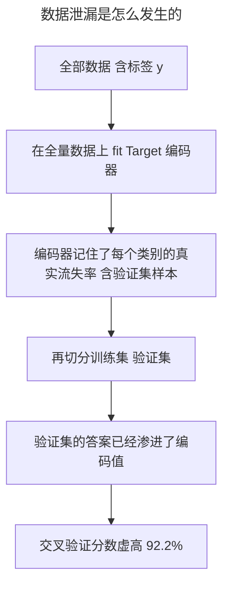

> 作者：轻松学AI
> 日期：2026-10-16
> 风格：通俗科普 + 实操教程
> 状态：待发布

# 机器学习实战 #06：用 Pipeline 把特征工程和模型拧成一股绳

同一个模型，同一份数据，只因为处理数据的顺序不同，交叉验证准确率一个是 92.2%，一个是 75.9%。

差了 16.3 个百分点。

高的那个是假的。它之所以高，是因为数据预处理的时候，编码器偷看了本不该看的东西——验证集的答案。这种错误有个名字叫**数据泄漏**，它是"离线评估很漂亮、模型一上线就拉胯"最常见的原因之一。

这一篇讲怎么用 scikit-learn 的 `Pipeline` 把特征工程和模型拧成一个整体，顺便把这个 16 个百分点的事故完整复现一遍——看清楚它是怎么发生的，才知道怎么躲开。

## 事故现场：编码器偷看了答案

先说清楚泄漏是怎么来的。

上一篇提到过 Target 编码——把每个类别映射成"这个类别下目标变量的平均值"。它信息量大，但危险，因为它直接用到了标签 y。

想象这么一个流程：你有一个高基数的"客户画像"列，想用 Target 编码把它变成数字。一个很自然、但错误的做法是——先在**整个数据集**上算好每个画像的平均流失率，编码完，再把数据切成训练集和验证集做交叉验证。

问题出在哪？编码的那一刻，编码器已经"看过"了全部样本的流失标签，包括那些即将被划进验证集的样本。于是验证集的答案，通过编码后的数值，悄悄渗进了训练数据。模型在验证集上考得好，不是因为它学到了规律，是因为考卷的答案提前印在了题目里。





左边红色的柱子，就是这么跑出来的——92.2%。看起来是个相当不错的模型。但它经不起上线考验：真实新客户来的时候，没有谁提前把答案告诉编码器，模型立刻露馅。

这就是为什么很多模型"实验室里 90 分，生产环境 70 分"。不是模型退化了，是实验室里的评估一开始就被污染了。

## 正确做法：把顺序交给 Pipeline 管

泄漏的根源是顺序错了：预处理不该在切分之前对全量数据做。

正确的顺序是：先切分，在每一折里，只用训练部分 fit 编码器，验证部分只做 transform、绝不参与编码器的训练。但手动管理这个顺序很容易出错——尤其当预处理步骤有好几个（填补、标准化、编码）的时候，你得保证每一步都在正确的子集上 fit。

scikit-learn 的 `Pipeline` 就是来解决这件事的。把所有预处理步骤和最终模型串成一个对象，交给交叉验证，它会自动保证：每一折里，整条管道只在该折的训练集上 fit，验证集只走 transform。

要把自定义的 Target 编码器放进 Pipeline，它得符合 sklearn 的接口——实现 `fit` 和 `transform`。配套仓库里是这么写的：

```python
class TargetMeanEncoder(BaseEstimator, TransformerMixin):
    """Target Mean 编码器，实现 sklearn Transformer 接口，可嵌进 Pipeline。
    fit 时记录每个类别的目标均值，transform 时按映射替换；
    fit 阶段没见过的类别在 transform 时退回全局均值。
    """
    def __init__(self, col):
        self.col = col

    def fit(self, X, y):
        y_series = pd.Series(np.asarray(y), index=X.index)
        merged = pd.DataFrame({self.col: X[self.col], "y": y_series})
        self.global_mean_ = float(merged["y"].mean())
        self.mapping_ = merged.groupby(self.col)["y"].mean().to_dict()
        return self

    def transform(self, X):
        return X[[self.col]].apply(
            lambda s: s.map(self.mapping_).fillna(self.global_mean_)
        ).to_numpy()
```

关键在 `fit` 只接收当前这一折的训练数据。交叉验证的每一折会各自调用一次 `fit`，编码器学到的"类别 → 均值"映射，只来自该折的训练样本。验证样本里出现的新画像？`transform` 时用 `fillna(global_mean_)` 退回全局均值——这恰恰模拟了真实上线场景：遇到没见过的客户画像，只能用一个保守的默认值。

然后用 `ColumnTransformer` 把数值列和这个 Target 编码列分别处理，再接上分类器，串成完整管道：

```python
def build_pipeline(numeric_cols, target_enc_col):
    """构造完整 Pipeline：预处理器 + 逻辑回归分类器。"""
    return Pipeline([
        ("pre", build_preprocessor(numeric_cols, target_enc_col)),
        ("clf", LogisticRegression(max_iter=1000)),
    ])
```

## 两种写法，16 个百分点的差距

把两种做法并排放在一起，差别就是一行代码的位置。

错误写法——先在全量数据上 `fit_transform`，再交给交叉验证：

```python
def leaked_cv_score(df, target_col, numeric_cols, target_enc_col, seed=0):
    X = df[numeric_cols + [target_enc_col]]
    y = df[target_col]
    preprocessor = build_preprocessor(numeric_cols, target_enc_col)
    transformed = preprocessor.fit_transform(X, y)   # ← 泄漏发生在这里
    cv = StratifiedKFold(n_splits=5, shuffle=True, random_state=seed)
    scores = cross_val_score(LogisticRegression(max_iter=1000), transformed, y, cv=cv)
    return float(scores.mean())
```

正确写法——把管道整个交给交叉验证，让它在每折内部 fit：

```python
def correct_cv_score(df, target_col, numeric_cols, target_enc_col, seed=0):
    X = df[numeric_cols + [target_enc_col]]
    y = df[target_col]
    pipe = build_pipeline(numeric_cols, target_enc_col)   # ← 管道整体进 CV
    cv = StratifiedKFold(n_splits=5, shuffle=True, random_state=seed)
    scores = cross_val_score(pipe, X, y, cv=cv)
    return float(scores.mean())
```

差别只有两个字：`fit_transform` 在交叉验证**之外**调用，还是把整条 Pipeline 丢**进**交叉验证。但结果天差地别：

| 管道 | 做法 | 5 折交叉验证平均准确率 |
|------|------|----------------------|
| 泄漏管道 | 先 fit_transform 全量数据，再切分 | 0.9220 |
| 正确管道 | Pipeline 整体，每折内部 fit | 0.7598 |

泄漏管道的 92.2% 是幻觉，正确管道的 76.0% 才是这个模型在没见过的数据上的真实水平。16 个百分点的差距，就是"编码器偷看验证集答案"带来的虚假收益。

## 为什么工业界几乎都用 Pipeline

讲到这你可能会想：我小心一点，手动保证每次都先切分再处理，不就行了？

理论上行，实践中很难。真实项目的预处理不止一步——缺失值填补、标准化、编码、特征选择，可能五六步串在一起。只要其中任何一步在切分之前碰了全量数据，泄漏就发生了。步骤越多，手动管理越容易漏。而且这种 bug 不会报错、不会崩溃，它只会让你的离线分数好看，等上线才暴露——那时候代价就大了。

Pipeline 把"正确的顺序"从"靠人记住"变成"框架强制保证"。你只要把步骤声明清楚，交叉验证、网格搜索这些需要反复切分数据的操作，都会自动在每个子集上正确地 fit/transform。这不是为了代码好看，是为了从结构上堵死数据泄漏这条路。

说白了，Pipeline 的价值不在"少写几行代码"，在"让你不可能把顺序搞错"。

这一篇没有新算法，`ColumnTransformer`、`Pipeline` 都是 sklearn 的标准组件。但它讲的是实战里最隐蔽、也最致命的一类错误——数据泄漏不会给你报错信息，只会给你一个好看到不真实的分数，然后在上线那天狠狠还回来。

下次你看到交叉验证分数高得让自己都意外，先别高兴。回头检查一遍：有没有哪个预处理步骤，在切分训练测试集之前，碰过了全量数据？

---

本文的 Target 编码器、两套管道实现与泄漏对比代码，以及分数对比图的真实数据，都在配套仓库里：[ml-practice](https://github.com/Joneyao/ml-practice)。

- [scikit-learn: Pipelines and composite estimators](https://scikit-learn.org/stable/modules/compose.html)
- [scikit-learn: Common pitfalls - Data leakage](https://scikit-learn.org/stable/common_pitfalls.html#data-leakage)
- [Kaggle: Telco Customer Churn](https://www.kaggle.com/datasets/blastchar/telco-customer-churn)
- [Abhishek Thakur, Approaching (Almost) Any Machine Learning Problem](https://github.com/abhishekkrthakur/approachingalmost)
- [数据泄漏：机器学习中最隐蔽的坑（知乎）](https://zhuanlan.zhihu.com/p/150560205)
