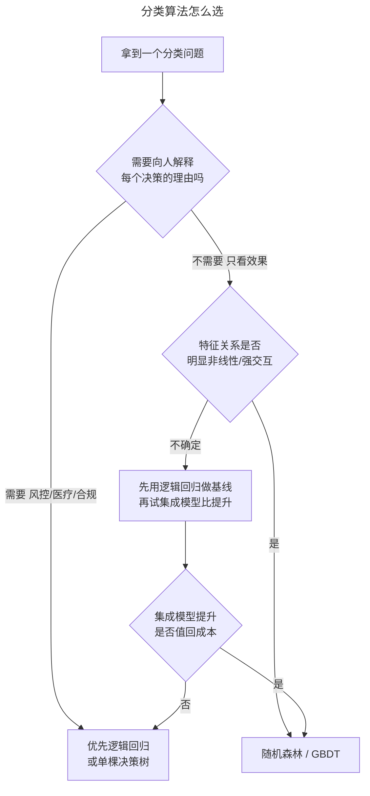

> 作者：轻松学AI
> 日期：2026-10-16
> 风格：通俗科普 + 实操教程
> 状态：待发布

# 机器学习实战 #08：分类问题，选算法不是看榜，是看场景

在电信客户流失数据上，我把三个分类算法放在完全相同的交叉验证流程里比了一轮：逻辑回归、随机森林、梯度提升树（GBDT）。

结果有点出人意料。最简单的逻辑回归，准确率 0.804、AUC 0.845；号称更强的随机森林，准确率 0.788、AUC 0.826，反而垫底；GBDT 准确率 0.802、AUC 0.847，和逻辑回归基本打平。

一个线性模型，追平甚至超过了两个集成模型。

这不是说随机森林不好，而是要说一件事：**选算法从来不是看哪个榜单分数高，是看哪个最匹配你的数据、你的约束、你的场景。** 这一篇讲怎么在同一把尺子下公平地比算法，以及比出结果之后，凭什么做选择。

## 公平比较的前提：同一套交叉验证

比算法最容易犯的错，是每个算法用不同的评估方式——这个用单次切分，那个用交叉验证，根本没有可比性。

要公平，就得让所有算法走完全相同的流程：同一份数据、同一种划分、同一个评估指标。配套仓库里用 `StratifiedKFold` 统一了这件事：

```python
def compare_algorithms(X, y, seed=0):
    """三种算法在同一 StratifiedKFold 下对比。"""
    cv = StratifiedKFold(n_splits=5, shuffle=True, random_state=seed)
    models = {
        "logreg": LogisticRegression(max_iter=1000),
        "random_forest": RandomForestClassifier(n_estimators=100, random_state=seed),
        "gbdt": GradientBoostingClassifier(random_state=seed),
    }
    rows = []
    for name, model in models.items():
        rows.append({"algorithm": name, **_eval(model, X, y, cv)})
    return pd.DataFrame(rows)
```

注意用的是 `StratifiedKFold` 而不是普通 `KFold`。分类问题里，分层（stratified）保证每一折的类别比例和整体一致——流失客户如果占 26%，那每一折都保持大约 26%。不分层的话，某一折可能恰好分到特别多或特别少的流失客户，分数就会忽高忽低，比较失去意义。

评估同时记了三样东西：准确率、AUC，还有训练耗时。最后这个经常被忽略，但它在真实项目里往往是决定性的。

```python
def _eval(model, X, y, cv):
    t0 = time.perf_counter()
    scores = cross_validate(model, X, y, cv=cv, scoring=["accuracy", "roc_auc"])
    fit_seconds = time.perf_counter() - t0
    return {
        "accuracy": float(scores["test_accuracy"].mean()),
        "roc_auc": float(scores["test_roc_auc"].mean()),
        "fit_seconds": float(fit_seconds),
    }
```

## 三个算法各自在干什么

比之前，先搞清楚这三个算法的脾气，否则看到结果也不知道为什么。


**逻辑回归**：给每个特征配一个权重，加权求和再过一个 sigmoid 变成概率。它本质是在特征空间里画一条直线（或超平面）来分开两类。优点是训练快、可解释——每个权重的正负和大小直接告诉你"这个特征对流失的影响有多大、是正是负"。缺点是只能学线性关系，特征之间复杂的交互它看不到。

**随机森林**：训练一大堆决策树，每棵树看数据的一个随机子集和特征的一个随机子集，最后投票。它能自然地捕捉非线性关系和特征交互，不需要你手动构造交叉特征。缺点是模型大、训练慢，而且"一片森林投票"的结果很难解释清楚。

**GBDT（梯度提升树）**：也是一堆树，但不是并行投票，而是串行——每棵新树专门去修正前面所有树犯的错。这种"盯着残差逐步改进"的方式通常精度很高，是很多数据竞赛的常胜将军。代价是训练更慢，而且对超参数更敏感。

搞懂这三种脾气，就能解释为什么这次是逻辑回归赢：电信流失数据的决定因素——合同类型、在网时长、月费——和流失之间的关系相当接近线性。合同越短越容易走、在网越久越稳定，这种单调关系逻辑回归一条直线就拟合得很好。随机森林和 GBDT 的非线性表达力，在这份数据上没有用武之地，反而因为模型复杂、容易在噪声上过拟合，略微吃了亏。

说白了，**模型的表达力不是越强越好，是要和数据的真实复杂度匹配。** 用大炮打蚊子，不仅浪费，还可能打偏。

## 精度接近时，用什么做决断

来看完整的对比结果：

| 算法 | 准确率 | ROC-AUC | 训练耗时 |
|------|--------|---------|---------|
| 逻辑回归 | 0.804 | 0.845 | 3.4s |
| 随机森林 | 0.788 | 0.826 | 2.4s |
| GBDT | 0.802 | 0.847 | 3.1s |


逻辑回归和 GBDT 的 AUC 几乎一样（0.845 对 0.847），差距小到可以忽略。当两个算法精度打平时，决断就不能再看精度了，得看别的维度：

**可解释性**。逻辑回归能直接告诉业务方"月付合同的客户流失概率显著更高，系数是 +1.2"，这种解释能直接变成挽留策略。GBDT 给你一个 0.847 的 AUC，但你很难向老板解释清楚它凭什么判定某个客户要流失。在金融、医疗、风控这些需要向监管或用户解释决策的场景，可解释性常常比零点几个百分点的精度更重要。

**训练和维护成本**。这份数据小，三者耗时都在几秒，差别不明显。但数据量涨到百万行、特征涨到几千维时，GBDT 的训练时间会远超逻辑回归。如果你的模型需要每天重训、每次都要调参，这个成本会累积成真金白银。

**对新数据的鲁棒性**。逻辑回归模型简单，参数少，面对分布漂移时往往更稳；复杂模型拟合得越精细，越容易在数据变化时翻车。

所以这道题的答案是：**在这份数据上，选逻辑回归。** 不是因为它精度最高（和 GBDT 打平），而是因为在精度打平的前提下，它更快、更可解释、更稳。这就是"看场景选算法"的完整含义。

## 一张给实战用的选择地图

把上面的判断整理成一个可操作的流程：



这张图的核心是那个"先用逻辑回归做基线"的分支。实战里最靠谱的做法不是一上来就上最复杂的模型，而是：**先用一个简单、快速、可解释的模型（逻辑回归）建立基线，再逐步尝试更复杂的模型，看它带来的提升值不值回多出来的成本。** 如果 GBDT 比逻辑回归只高 0.2%，但训练慢 10 倍、还没法解释，那这 0.2% 大概率不值得。

这也是为什么资深的数据科学家很少迷信某个"最强算法"。他们知道，算法只是工具箱里的不同工具，没有哪把扳手永远最好用，只有最适合当前这颗螺丝的那把。

这一篇没有新代码，`LogisticRegression`、`RandomForestClassifier`、`GradientBoostingClassifier` 都是 sklearn 调一行的标准模型。难的是那个判断框架：公平地比，然后在精度之外，把可解释性、成本、鲁棒性一起放进决策。

下一篇是这组的重头戏——当要预测的"坏人"只占 0.17% 的时候，连准确率这个最基本的指标都会骗你。

---

本文的三算法统一对比代码，以及准确率/AUC/耗时对比图的真实数据，都在配套仓库里：[ml-practice](https://github.com/Joneyao/ml-practice)。

- [Kaggle: Telco Customer Churn](https://www.kaggle.com/datasets/blastchar/telco-customer-churn)
- [scikit-learn: Ensemble methods](https://scikit-learn.org/stable/modules/ensemble.html)
- [scikit-learn: Cross-validation](https://scikit-learn.org/stable/modules/cross_validation.html)
- [逻辑回归 vs 随机森林 vs GBDT 怎么选（掘金）](https://juejin.cn/post/6844903809130414087)
