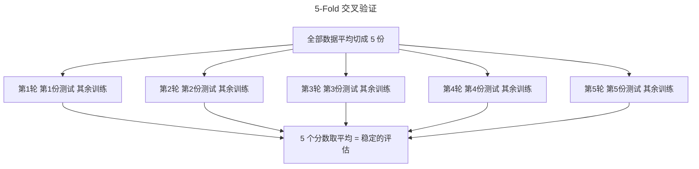

> 作者：轻松学AI
> 日期：2026-10-16
> 风格：通俗科普 + 实操教程
> 状态：待发布

# 机器学习实战 #10：交叉验证不是跑一遍就完事

同一份房价数据，同一个线性回归模型，我只改了一个东西——`train_test_split` 的随机种子。

种子设成 3，模型的 R² 是 0.495。种子设成 2，R² 是 0.853。

什么都没变，就因为"哪些样本被分到了测试集"不同，模型评分从 0.49 跳到 0.85。如果你只跑一次切分、恰好抽到种子 3，你会以为这模型很烂；恰好抽到种子 2，你又会以为它很强。两个结论都是假的。

这就是为什么**单次 train_test_split 的分数根本不能信**，以及为什么交叉验证不是"更严谨的可选项"，而是评估模型的必需品。这一篇讲清楚 K-Fold 到底在做什么，以及它为什么能把这种运气成分摁下去。

## 单次切分的分数，一半是运气

先看单次切分在干什么。`train_test_split` 把数据随机切成两份——比如 80% 训练、20% 测试，模型在训练集上学，在测试集上打分。

问题是"随机切"这三个字。测试集里具体落了哪 20% 的样本，纯看随机种子。如果这 20% 恰好都是模型容易预测的样本，分数就虚高；如果恰好抽中一批难缠的异常样本，分数就偏低。数据量越小、或者数据里的个体差异越大，这种波动就越剧烈。

配套仓库里把这件事量化了——用 10 个不同的随机种子，各做一次单切分，看分数怎么跳：

```python
def single_split_scores(X, y, seeds=(0, 1, 2, 3, 4)):
    """对每个随机种子各做一次 train_test_split，返回每次的 R²。"""
    rows = []
    for s in seeds:
        Xtr, Xte, ytr, yte = train_test_split(X, y, test_size=0.2, random_state=s)
        model = LinearRegression().fit(Xtr, ytr)
        rows.append({"seed": s, "r2": float(model.score(Xte, yte))})
    return pd.DataFrame(rows)
```

在 Ames 房价数据上跑这 10 次，R² 的分布是这样的：

最低 0.495（种子 3），最高 0.853（种子 2），其余散落在中间。**同一个模型，分数能差出 0.36。** 这个差距比很多"模型 A 比模型 B 好多少"的真实差异还大。换句话说，如果你用单次切分去比较两个模型谁更好，你比到的很可能是"谁的随机种子运气更好"，而不是"谁真的更强"。

## K-Fold：让每个样本都当一次测试集

交叉验证的思路很朴素：既然"抽哪一份当测试集"会带来运气波动，那就别只抽一次，让每一份都轮流当一次测试集，最后取平均。

K-Fold 就是这么干的。把数据平均切成 K 份（比如 5 份），然后做 K 轮：每一轮拿其中 1 份当测试集、其余 K-1 份当训练集，训练、打分；5 轮下来每一份都恰好当过一次测试集。最后把 5 个分数平均，这个平均分就比任何单次切分都稳得多。


下面这张流程图也描述了同一个过程：



代码上，sklearn 的 `cross_val_score` 把整个过程包成了一行。配套仓库里还顺手记了标准差，用来衡量"分数有多稳"：

```python
def kfold_scores(X, y, n_splits=5, seed=0):
    """K-Fold 交叉验证，返回每折 R² + 均值 + 标准差。"""
    kf = KFold(n_splits=n_splits, shuffle=True, random_state=seed)
    scores = cross_val_score(LinearRegression(), X, y, cv=kf, scoring="r2")
    return {
        "fold_scores": [float(s) for s in scores],
        "mean": float(scores.mean()),
        "std": float(scores.std()),
    }
```

在同一份房价数据上跑 5-Fold，结果是：平均 R² = 0.785，标准差 0.078。

把单次切分的乱象和 K-Fold 的稳定放在一起对比：


左边 10 个蓝点是 10 次单切分的分数，散得到处都是（0.495 到 0.853）；右边红色的点加误差棒是 K-Fold 的均值±标准差，稳稳地落在 0.785 附近。K-Fold 给的不只是一个"更好"的数字，它给的是一个**可信**的数字——以及一个标准差，告诉你这个数字本身有多可靠。

那个标准差（0.078）也很有价值。它量化了模型分数的波动范围。如果你比较两个模型，A 的交叉验证分数是 0.80±0.08、B 是 0.82±0.08，这两个 0.02 的差距完全被淹没在各自 0.08 的波动里——这时候说"B 比 A 好"是不负责任的。标准差让你知道，什么时候的差距是真的，什么时候只是噪声。

## 分类问题要用 StratifiedKFold

普通 K-Fold 随机切分，在回归问题上没问题。但到了分类问题，尤其是类别不均衡时，它会出乱子。

设想一个流失率 26% 的数据，随机切 5 份，某一折可能恰好分到 40% 的流失客户，另一折只有 15%。每一折的类别比例都不一样，评估自然失真——更极端的情况（比如上一篇讲的 0.17% 欺诈率），某一折甚至可能一个正例都没有，直接让评估崩溃。

`StratifiedKFold`（分层 K-Fold）解决这个问题：它在切分时保证每一折的类别比例都和整体一致。整体 26% 流失，那每一折都维持大约 26%。前面几篇做分类对比时，我们一直用的就是它——现在你知道为什么了。

记一个简单规则：**回归问题用 `KFold`，分类问题用 `StratifiedKFold`。** sklearn 里 `cross_val_score` 对分类器其实会默认启用分层，但显式写出来更稳妥，也让代码意图清楚。

## 几折合适

最后一个实际问题：K 取多少？

常用的是 5 或 10。折数越多，每次用于训练的数据越多（10 折时每轮用 90% 训练），评估的偏差越小；但折数越多，要训练的模型个数也越多（10 折要训 10 次），计算成本线性上升。5 折是精度和成本之间最常用的折中，数据量不大时用 10 折也无妨。

有一个极端是"留一法"（leave-one-out）——K 等于样本总数，每次只留 1 个样本当测试。它评估最充分，但要训练 N 次模型，数据量一大就贵得离谱，通常只在样本极少时才用。

这一篇的代码就 `KFold`、`cross_val_score` 几行，都是 sklearn 标准件。但它纠正的是一个特别常见、又特别隐蔽的习惯——跑一次 `train_test_split` 看个分数就下结论。记住那组数字：同一个模型，单次切分能从 0.495 跳到 0.853。你凭一次切分得出的任何结论，都可能是运气在替你说话。

下一篇讲调参：当你要在几十上百组超参数里挑最优的时候，是该老老实实网格搜索，还是随机抽几组碰运气？

---

本文的单切分波动与 K-Fold 稳定性对比代码，以及对比图的真实数据，都在配套仓库里：[ml-practice](https://github.com/Joneyao/ml-practice)。

- [Kaggle: House Prices - Advanced Regression Techniques](https://www.kaggle.com/competitions/house-prices-advanced-regression-techniques)
- [scikit-learn: Cross-validation](https://scikit-learn.org/stable/modules/cross_validation.html)
- [Aurélien Géron, Hands-On Machine Learning (3rd ed.), Chapter 2](https://www.oreilly.com/library/view/hands-on-machine-learning/9781098125967/)
- [交叉验证到底在验证什么（知乎）](https://zhuanlan.zhihu.com/p/24825503)
