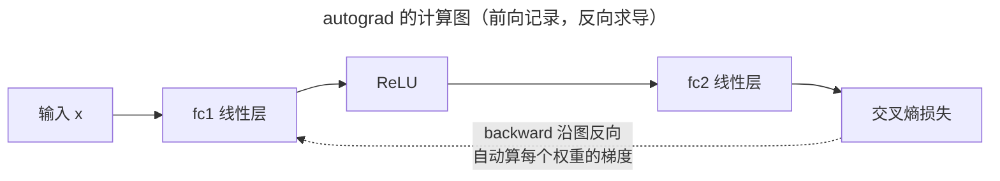

> 作者：轻松学AI
> 日期：2026-10-16
> 风格：通俗科普 + 实操教程
> 状态：待发布

# 机器学习实战 #13：从 sklearn 到 PyTorch，换个框架，同样的损失和梯度下降

入门系列的最后，我们用纯 NumPy 手写过一个神经网络——几百行代码，自己实现前向传播、自己推导反向传播的链式法则、自己写梯度下降的更新，让它识别 8×8 的手写数字，准确率做到了 95% 左右。

这一篇，我们把同一个网络用 PyTorch 重写一遍。结果是：**十几行代码，达到几乎一样的效果。**

这不是要说手写那几百行白费了——恰恰相反。只有先手写过一遍，你才能真正看懂 PyTorch 那十几行背后发生了什么，以及为什么说"框架不是魔法"。这一篇就做这个对照。

## 同一个网络，两种写法

先回忆入门系列手写的那个 MLP 长什么样：输入层 64 个节点（8×8 像素拉直），一个 64 神经元的隐藏层配 ReLU 激活，输出层 10 个节点对应数字 0-9，用 softmax 配交叉熵。

用 PyTorch 描述同一个结构，是这样：

```python
class TorchMLP(nn.Module):
    """单隐藏层 MLP：Linear(64→hidden) → ReLU → Linear(hidden→10)。
    结构与手写版完全一致；softmax 由 CrossEntropyLoss 隐含。
    """
    def __init__(self, hidden_size=64):
        super().__init__()
        self.fc1 = nn.Linear(64, hidden_size)
        self.relu = nn.ReLU()
        self.fc2 = nn.Linear(hidden_size, 10)

    def forward(self, x):
        return self.fc2(self.relu(self.fc1(x)))
```

对照手写版，每一行都能一一对应。手写版里，你得自己创建权重矩阵 `W1`、`W2` 和偏置，还要用 He 初始化小心翼翼地设好初始值；PyTorch 里 `nn.Linear(64, hidden_size)` 一句话就把权重、偏置、初始化全包了。手写版里，前向传播是你手写的"矩阵乘 + 加偏置 + ReLU"；PyTorch 里就是 `forward` 里那一行函数调用的嵌套。

最值得注意的是 softmax 去哪了。手写版里，输出层要显式写一个 softmax 把 10 个打分变成概率分布。PyTorch 版的 `forward` 里没有 softmax——因为它被包进了损失函数 `CrossEntropyLoss` 里。PyTorch 的交叉熵损失默认接收未经 softmax 的原始打分（logits），内部自己做 softmax。这不是省略，是把两步合并成了数值上更稳定的一步，和手写版"softmax + 交叉熵合并求导"的优化是同一个道理。

## 训练循环：手写的每一步，框架都替你做了

真正体现"框架不是魔法"的，是训练循环。先看手写版一轮训练要做的四件事：前向算出预测、算交叉熵损失、反向传播手推每个权重的梯度、梯度下降更新参数。手写版里，第三步"反向传播"是最烧脑的——你得亲手把链式法则一层层写出来，算出损失对每个 W、b 的偏导。

PyTorch 版的训练循环是这样：

```python
def train_torch_mlp(X, y, hidden_size=64, lr=0.3, n_epochs=200, seed=0):
    torch.manual_seed(seed)
    Xt = torch.tensor(X, dtype=torch.float32)
    yt = torch.tensor(y, dtype=torch.long)
    model = TorchMLP(hidden_size=hidden_size)
    criterion = nn.CrossEntropyLoss()
    optimizer = torch.optim.SGD(model.parameters(), lr=lr)

    loss_history, acc_history = [], []
    for _ in range(n_epochs):
        optimizer.zero_grad()
        logits = model(Xt)                 # 前向
        loss = criterion(logits, yt)       # softmax + 交叉熵
        loss.backward()                    # autograd 自动反向
        optimizer.step()                   # 梯度下降更新
        ...
    return {"model": model, "loss_history": loss_history, "acc_history": acc_history}
```

把这四行和手写版的四步对一下：

- `logits = model(Xt)` ←→ 手写的前向传播
- `loss = criterion(logits, yt)` ←→ 手写的交叉熵损失计算
- `loss.backward()` ←→ **手写的那一大段反向传播链式法则**
- `optimizer.step()` ←→ 手写的"每个参数减去学习率乘梯度"

最关键的是 `loss.backward()` 这一行。它取代了手写版里最复杂、最容易出错的整段反向传播代码。PyTorch 的自动微分（autograd）在你做前向传播时，悄悄记录了每一步运算构成的计算图；调用 `backward()` 时，它沿着这张图自动反向求导，算出所有参数的梯度。**你手写链式法则辛辛苦苦推导出来的东西，autograd 一行就自动算完了——而且算的是同一个梯度。**

这就是为什么说框架不是魔法。它没有发明新的数学，它只是把你手写过的前向、反向、更新这三件事，做成了标准化、自动化、数值稳定的工具。`nn.Module` 管结构，`autograd` 管求导，`optimizer` 管更新——每一块都对应着你手写时亲手做过的某一步。


## 行为一致：这才是"看懂了"的证据

光说结构对应还不够，得验证两个版本跑出来的行为真的一致。

在同一份 8×8 digits 数据、同样的网络结构下训练 PyTorch 版，训练曲线是这样的：


左图损失从 2.31（接近 ln10≈2.30，正好是 10 分类随机瞎猜的理论损失）单调下降到 0.16；右图准确率一路爬升，最终稳定在 0.963。

这个 0.963，和入门系列手写版报告的约 0.95，落在同一个水平。两条曲线的形状也一样——损失单调下降、准确率单调上升，都是典型的健康收敛。同一个网络、同一份数据，手写版和框架版给出了相同的收敛行为。

autograd 自动求导的秘密，在于它记录了一张"计算图"：



前向传播时，PyTorch 把每一步运算连成这张图；调用 `backward()` 时，它沿图反向走一遍，用链式法则自动算出每个节点的梯度。你手写时推导的那些偏导，就是这张图上反向流动的东西。

这个"相同"非常有说服力。如果 PyTorch 是个黑盒魔法，它凭什么和你手写的 NumPy 代码跑出一样的结果？答案是：它们本来就在做同一件数学运算。autograd 自动算的梯度，和你用链式法则手推的梯度，数值上就是同一个东西；SGD 的更新，和你手写的"减去学习率乘梯度"，是同一个公式。框架把过程工程化了，但数学内核没变。

这也正是入门系列那几百行手写代码的价值所在：它让你拥有了"看穿框架"的能力。现在你用 PyTorch，不是在念咒语，而是清楚地知道 `loss.backward()` 背后那张计算图在做什么。

## 那为什么还要用框架

既然数学是一样的，手写也能做到，为什么工业界都用 PyTorch？

一是**自动微分**。手写 MLP 的反向传播还能勉强推导，但换成有几十层、几百万参数的现代网络，手推梯度几乎不可能，还极易出错。autograd 让你只管搭前向结构，反向自动搞定——这是深度学习能做大的前提。

二是**工程设施**。GPU 加速、批量数据加载、各种优化器（不只是 SGD，还有 Adam 等）、现成的网络层（卷积、注意力……），框架全给你备好了。手写这些的成本高到不现实。

三是**生态**。预训练模型、社区实现、部署工具，都围绕主流框架建立。用框架意味着你能站在整个社区的肩膀上。

但这些便利有一个前提才能用好：你得知道底层在做什么。一个只会调 `model.fit()`、不知道 `loss.backward()` 背后是梯度的人，遇到模型不收敛、梯度爆炸、损失变 NaN 时会束手无策。而手写过一遍的你，知道去哪里找问题——是学习率太大了？是初始化不对？是某一层的梯度消失了？这些直觉，只有理解了内核才有。

这一篇的 PyTorch 代码就十几行，`nn.Module`、`CrossEntropyLoss`、`loss.backward()` 都是标准 API。但它串起了入门系列到实战系列的一条主线：先手写理解原理，再用框架高效工作。框架是省力的工具，不是替你思考的黑盒。

下一篇是整个系列的收官——我们用 PyTorch 搭一个真正的卷积神经网络，做图像分类，顺便亲眼看看入门系列讲过的"过拟合"，在真实训练里长什么样。

---

本文的 PyTorch MLP 实现与训练曲线代码都在配套仓库里：[ml-practice](https://github.com/Joneyao/ml-practice)；对照的手写 MLP 在入门系列配套仓库 [ml-from-scratch](https://github.com/Joneyao/ml-from-scratch)。

- [PyTorch 官方教程：Deep Learning with PyTorch - A 60 Minute Blitz](https://docs.pytorch.org/tutorials/beginner/blitz/)
- [PyTorch: torch.nn 文档](https://docs.pytorch.org/docs/stable/nn.html)
- [PyTorch: autograd 机制](https://docs.pytorch.org/docs/stable/notes/autograd.html)
- [sklearn digits 数据集](https://scikit-learn.org/stable/datasets/toy_dataset.html#digits-dataset)
- [一文看懂 PyTorch autograd（知乎）](https://zhuanlan.zhihu.com/p/69294347)
