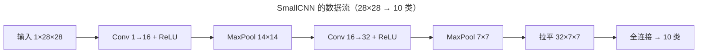

> 作者：轻松学AI
> 日期：2026-10-16
> 风格：通俗科普 + 实操教程
> 状态：待发布

# 机器学习实战 #14：图像分类实战，CNN 入门与一个真实的小项目

上一篇我们用 PyTorch 重写了全连接网络。但真要处理图像，全连接有个大问题：把一张 28×28 的图拉成 784 个像素的一维向量，图里"相邻像素是一伙的"这种空间结构，就被彻底打散了。

卷积神经网络（CNN）就是为图像而生的。这一篇我们搭一个小 CNN，在 Fashion-MNIST（10 类服饰图像）上做分类，顺便亲眼看看入门系列反复强调的"过拟合"——在真实训练里，它长什么样。

作为整个系列的收官，这一篇也是前面所有内容的一次汇合：卷积是新的，但训练循环、损失、过拟合诊断，全是前面铺垫过的东西。

## 卷积在做什么：局部感受 + 参数共享

先用直觉理解卷积，不碰公式。

全连接层让每个输出都连着所有输入——处理图像时，这意味着左上角的像素和右下角的像素被同等对待，网络得从零学起"哪些像素挨在一起"。卷积换了个思路：用一个小窗口（卷积核，比如 3×3）在图像上滑动，每次只看窗口覆盖的一小块局部区域，提取这块区域的特征（边缘、纹理、角点）。

这带来两个关键好处。一是**局部感受**：它天然尊重图像的空间结构，只看相邻像素的关系，符合"图像的意义藏在局部模式里"这个事实。二是**参数共享**：同一个卷积核在整张图上滑动复用，识别"竖直边缘"的那组权重，图像哪个位置都能用。相比全连接动辄几十万参数，卷积用少得多的参数就能提取特征，还不容易过拟合。


配套仓库里的小 CNN 就两个卷积块，结构很简单：

```python
class SmallCNN(nn.Module):
    """2 卷积块 + 全连接（Fashion-MNIST 版，1 通道 28×28）：
    Conv(1→16)→ReLU→MaxPool → Conv(16→32)→ReLU→MaxPool → FC→10。
    """
    def __init__(self):
        super().__init__()
        self.features = nn.Sequential(
            nn.Conv2d(1, 16, kernel_size=3, padding=1), nn.ReLU(), nn.MaxPool2d(2),
            nn.Conv2d(16, 32, kernel_size=3, padding=1), nn.ReLU(), nn.MaxPool2d(2),
        )
        self.classifier = nn.Linear(32 * 7 * 7, 10)

    def forward(self, x):
        x = self.features(x)
        x = x.flatten(1)
        return self.classifier(x)
```

读一下这个结构。第一个卷积块 `Conv2d(1, 16)` 把 1 通道的灰度图变成 16 个特征图（学 16 种不同的局部模式），ReLU 加非线性，`MaxPool2d(2)` 把图缩小一半（28→14）、保留最显著的响应。第二块 `Conv2d(16, 32)` 在前面的特征上再提取 32 种更复杂的模式，又池化一次（14→7）。最后把 32×7×7 的特征图拉平，用一个全连接层映射到 10 个类别。

整条数据流是这样走的：



卷积提特征、池化降尺寸、全连接做分类——这是最经典的 CNN 骨架。现代的大网络再复杂，核心也是这三样的堆叠。

## 训练：全是前面用过的零件

CNN 怎么训练？答案很提气——和上一篇的 MLP 一模一样，没有任何新东西。

```python
def train_cnn(train_ds, val_ds, n_epochs=5, lr=0.001, batch_size=64, seed=0):
    train_loader = DataLoader(train_ds, batch_size=batch_size, shuffle=True)
    val_loader = DataLoader(val_ds, batch_size=batch_size)
    model = SmallCNN()
    criterion = nn.CrossEntropyLoss()
    optimizer = torch.optim.Adam(model.parameters(), lr=lr)
    ...
    for _ in range(n_epochs):
        tl, ta = _run_epoch(model, train_loader, criterion, optimizer)
        with torch.no_grad():
            vl, va = _run_epoch(model, val_loader, criterion, None)
        ...
```

还是那套：交叉熵损失、`loss.backward()` 自动求导、优化器更新参数。唯一的变化是优化器从 SGD 换成了 Adam（一种更智能的梯度下降变体，自动调整每个参数的学习步长，在深度网络上通常收敛更快），以及引入了 `DataLoader` 做小批量训练——数据分批喂进去，而不是一次性全灌。

这正是整个系列想传达的：复杂的东西，都是简单零件的组合。你会训 MLP，就会训 CNN，因为训练的框架是同一个。换的只是网络结构那一块，其余的损失、反向、优化、评估，前面十几篇早就讲透了。

## 过拟合长什么样：两条曲线开始分家

重点来了。入门系列讲过拟合时说：模型在训练集上越来越好，但在没见过的数据上不再进步，甚至变差。那是文字描述。现在用真实训练的曲线，看它具体长什么样。

在 Fashion-MNIST 的一个子集上训 8 轮，记录每轮训练集和验证集各自的损失与准确率：


读这两张图。训练准确率（蓝线）一路往上爬，从 0.57 涨到 0.875，势头不减；验证准确率（橙线）前几轮跟着涨，从 0.71 到 0.85 左右，但到第 6 轮之后开始放缓、甚至微微回落。损失图上更明显：训练损失持续下降，验证损失到后期降不动了，趋于平缓。

**两条曲线从贴合到开始分家的那个点，就是过拟合的起点。** 训练准确率还在涨，说明模型在继续"记住"训练集的细节；但验证准确率停滞，说明这些多记住的细节是训练集独有的噪声，对新数据没用。模型从"学习通用规律"滑向了"背诵训练样本"。

这张图把入门系列的抽象定义变成了可观测的现象。实战中，你就是靠盯着这两条曲线来判断该不该停：当验证曲线不再改善、而训练曲线还在涨，就该停了（这叫早停，early stopping），再练下去只会过拟合得更严重。如果想让模型练更久也不过拟合，就得加正则化手段——Dropout、权重衰减、数据增强，这些是下一个台阶的内容。

## 这是教学配置，不是性能标杆

得说清楚：这个小 CNN 不是用来刷精度的。为了在普通 CPU 上几分钟就能跑完，它用了很小的模型（两个卷积块）、很少的训练轮数、还只取了数据集的一个子集。真要追求 Fashion-MNIST 的高准确率，得用更深的网络、完整数据、GPU 训练几十上百轮，再配上数据增强和正则化。

这里刻意保持简单，是为了让你看清骨架——卷积怎么提特征、训练循环怎么跑、过拟合怎么从曲线上显形。骨架看懂了，往上加深度、加技巧，都是水到渠成的事。

这一篇的代码，卷积层、池化层、Adam、DataLoader 全是 PyTorch 标准件，拼起来几十行。但它完成了整个系列的收束：从入门系列手写的感知机、反向传播、MLP，到这一篇用框架搭的 CNN，你走完了一条完整的路——理解原理，再用工具高效实现。

十四篇走下来，从一份打不开的脏 CSV，到数据清洗、特征工程、建模选型、调参评估、模型部署，再到深度学习，机器学习实战的主干流程你已经完整走过一遍。工具会变，框架会更新，但这条"拿到数据、理解它、建模、评估、落地"的主线不会变。接下来，是你拿自己的数据，走自己的一遍了。

---

本文的 CNN 实现与训练曲线代码都在配套仓库里：[ml-practice](https://github.com/Joneyao/ml-practice)。

- [PyTorch 官方教程：训练一个图像分类器](https://docs.pytorch.org/tutorials/beginner/blitz/cifar10_tutorial.html)
- [PyTorch: torch.nn.Conv2d 文档](https://docs.pytorch.org/docs/stable/generated/torch.nn.Conv2d.html)
- [Fashion-MNIST 数据集](https://github.com/zalandoresearch/fashion-mnist)
- [卷积神经网络直观理解（知乎）](https://zhuanlan.zhihu.com/p/27908027)
- [Aurélien Géron, Hands-On Machine Learning (3rd ed.), 第 14 章 CNN](https://www.oreilly.com/library/view/hands-on-machine-learning/9781098125967/)
